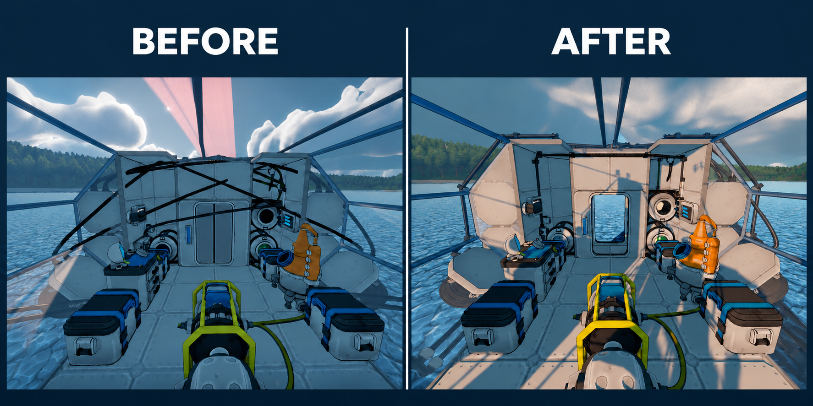

# Cables Management — StellarDrive Demo

[English below](#english)

Se você encontrar algum bug durante o uso do mod me envie uma mensagem no Discord que corrijo o mais rápido que conseguir.

Discord: **benmals0_0**

**Versão 1.0.0 · Criado por Ghost**

Presilhas para organizar os cabos da sua nave. Monte-as no chão, na parede ou no teto e passe cabos de sinal, energia ou tubos pelos dois lados. Use o alinhamento para manter o percurso reto e a pintura para identificar cada cabo pela cor.

## Recursos

- Três variantes de presilha, cada uma com símbolos na base: arcos para sinal, raio para energia e tubulação com seta de fluxo para tubos.
- Alinhamento com **Alt**, encaixe na orientação de outra presilha.
- Pintura de cabos com **P**, 16 cores, ajustes RGB/HEX.

## Instalação

### Requisitos

- **StellarDrive Demo**.
- **MelonLoader**.
- **SDModKit** feito por Krunk.

### Passo a passo

1. Feche o jogo.
2. Instale o MelonLoader e o SDModKit, caso ainda não estejam instalados.
3. Se estiver atualizando, remova a DLL anterior deste mod. Copie a DLL de desenvolvimento `CablesManagementMod.dll` para a pasta `Mods` da instalação do jogo.
4. Inicie o jogo e desbloqueie **Cables Management** na mesa de pesquisa, por **6 Iron**.
5. No menu de construção, escolha a presilha correspondente ao tipo de cabo. Cada uma custa **1 Iron**.
6. Monte a presilha e conecte um cabo em cada ponta.

## Como usar

### Presilhas

| Peça | Conexão |
| --- | --- |
| **Cables Management - Signal** | Cabos de sinal. |
| **Cables Management - Power** | Cabos de energia. |
| **Cables Management - Pipe** | Tubos de fluidos. |

Gire a presilha para orientar o canal na direção do percurso. Para conectar um cabo, mire na abertura de uma das pontas; os alvos ampliados também facilitam a conexão de frente, inclusive com a presilha deitada na parede.

### Alinhamento

| Controle ou indicação | Função |
| --- | --- |
| **Segurar Alt** durante a construção | Mostra a guia e aproxima a nova presilha do alinhamento de uma já instalada. |
| **Soltar Alt** | Retorna ao posicionamento livre. |

Coloque a primeira presilha, selecione outra e segure Alt enquanto aponta para a mesma superfície da nave. Aproxime a prévia da linha e coloque a peça quando ela encaixar.

### Pintura dos cabos

| Controle | Função |
| --- | --- |
| **P** | Abre a paleta e entra no modo de pintura. Durante a pintura, reabre a paleta. |
| **Botão esquerdo** | Pinta o cabo apontado. |
| **Botão do meio** | Copia a cor do cabo apontado. |
| **Botão direito** | Reabre a paleta. |
| **Esc** | Encerra a pintura. Selecionar outra ferramenta também encerra o modo. |

Clique em uma cor para começar a pintar. Use **Custom...** para ajustar RGB ou HEX e confirme em **Apply**. Para remover a pintura, selecione **Original** e clique no cabo.

---

## English

If you find a bug while using the mod, send me a message on Discord and I will fix it as soon as I can.

Discord: **benmals0_0**

**Version 1.0.0 · Created by Ghost**

Cable clips for organizing your ship's wiring and pipes. Mount them on floors, walls or ceilings and connect signal cables, power cables or fluid pipes at both ends. Use alignment to keep routes straight and painting to identify cables by color.

### Features

- Three clip variants, each with symbols on the base: signal arcs, lightning for power and a pipe with a flow arrow for fluid pipes.
- **Alt** alignment, snapping to the orientation of another clip.
- **P** cable painting with 16 colors and RGB/HEX controls.

### Installation

#### Requirements

- **StellarDrive Demo**.
- **MelonLoader**.
- **SDModKit** by Krunk.

#### Step by step

1. Close the game.
2. Install MelonLoader and SDModKit if they are not already installed.
3. If updating, remove this mod's previous DLL. Copy the development DLL, `CablesManagementMod.dll`, into the game's `Mods` folder.
4. Start the game and research **Cables Management** at the research table for **6 Iron**.
5. Choose the clip matching your cable type in the build menu. Each costs **1 Iron**.
6. Mount the clip and connect a cable to each end.

### How to use

#### Clips

| Part | Connection |
| --- | --- |
| **Cables Management - Signal** | Signal cables. |
| **Cables Management - Power** | Power cables. |
| **Cables Management - Pipe** | Fluid pipes. |

Rotate the clip to point its channel along the route. Aim at either opening to connect a cable. Larger targets also make the ends easier to select from the front, including horizontal wall-mounted clips.

#### Alignment

| Control or indicator | Function |
| --- | --- |
| **Hold Alt** while building | Shows the guide and snaps the new clip into alignment with an existing one. |
| **Release Alt** | Returns to free placement. |

Place the first clip, select another and hold Alt while aiming at the same ship surface. Move the preview toward the line and place it when it snaps.

#### Cable painting

| Control | Function |
| --- | --- |
| **P** | Opens the palette and enters painting mode. Reopens the palette while painting. |
| **Left mouse button** | Paints the targeted cable. |
| **Middle mouse button** | Picks the targeted cable's color. |
| **Right mouse button** | Reopens the palette. |
| **Esc** | Exits painting. Selecting another tool also exits the mode. |

Click a color to start painting. Open **Custom...** to adjust RGB or HEX and confirm with **Apply**. Choose **Original** and click a cable to remove its paint.
